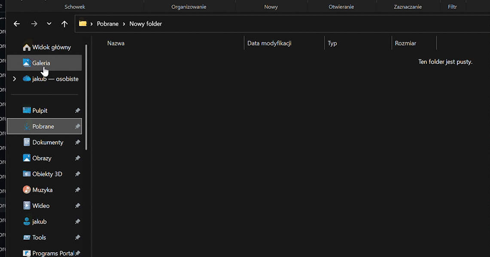

# Windhawk Mods Collection

A curated collection of high-performance, polished [Windhawk](https://windhawk.net/) mods designed to fix annoyances, enhance multitasking, and improve customization for the **Windows File Explorer** and **Taskbar** (Windows 10, Windows 11, and [ExplorerPatcher](https://github.com/valinet/ExplorerPatcher)).

---

## Mod Portfolio

| Mod | Mod ID | Target | Key Benefit | Preview |
|---|---|---|---|---|
| [**Copy Queue - Per Disk**](#1-copy-queue---per-disk-intelligent-drive-aware) | `copy-queue-per-disk` | `explorer.exe` | Independent drives copy in parallel; conflicting disks queue sequentially | *Zero-contention I/O* |
| [**Open Photos App instead of Gallery**](#2-open-photos-app-instead-of-gallery) | `explorer-gallery-photos-launcher` | `explorer.exe` | Redirects Explorer Gallery shortcut to Microsoft Photos or custom viewer | [demo.gif](#2-open-photos-app-instead-of-gallery) |
| [**Taskbar Tray Spacing & 2 Rows Grid**](#3-taskbar-tray-icon-spacing--2-rows-grid) | `taskbar-win10-tray-spacing` | `explorer.exe` | Compact 2-row balanced tray grid, custom spacing, no scroll arrows | [demo_tray.png](#3-taskbar-tray-icon-spacing--2-rows-grid) |

---

## 1. Copy Queue - Per Disk (Intelligent Drive-Aware)

**Source Code:** [`copy-queue-per-disk.wh.cpp`](./copy-queue-per-disk.wh.cpp)  
**Target:** `explorer.exe` (Windows File Explorer)  
**Authors:** Nerdworld & Jakub ([@jakubix30](https://github.com/jakubix30))  

### Overview & Problem Solved
By default, Windows Explorer either runs all file copy operations at the same time (causing severe disk head thrashing on HDDs and controller queue saturation / thermal throttling on SSDs) or forces everything into a single global bottleneck where copying to a USB stick freezes unrelated file transfers between internal NVMe drives.

**Copy Queue - Per Disk** provides intelligent, drive-aware queuing:
- **Independent transfers run in PARALLEL:** Copying from SSD 1 to USB Drive A while simultaneously copying between SSD 2 and HDD B runs concurrently at full hardware throughput.
- **Conflicting transfers are QUEUED:** If an operation shares a physical storage device with an ongoing transfer (same source, same destination, or cross-read/write), it waits until that device is free.
- **True Physical Drive Detection:** Uses `IOCTL_STORAGE_GET_DEVICE_NUMBER` to query hardware device numbers. Separate partitions on the same physical SSD/HDD (e.g. `C:` and `D:`) are correctly recognized as the same physical device!
- **Network Share Awareness:** UNC paths (`\\server\share\...`) are grouped per server host (`Net_<server>`) to prevent saturating bandwidth and overloading network shares.
- **Deadlock-Free Cross-Process Synchronization:** Mutex locks (`Local\Windhawk.CopyQueue.<diskKey>`) are acquired in strictly sorted lexicographical order across all Explorer windows and worker processes.
- **Zero Configuration:** Works completely out of the box with zero setup required.

---

## 2. Open Photos App instead of Gallery

**Source Code:** [`explorer-gallery-photos-launcher.wh.cpp`](./explorer-gallery-photos-launcher.wh.cpp)  
**Target:** `explorer.exe` (File Explorer Navigation Pane)  
**Author:** Jäkubix ([@jakubix30](https://github.com/jakubix30))  
**Pull Request:** [ramensoftware/windhawk-mods#5047](https://github.com/ramensoftware/windhawk-mods/pull/5047)  

### Overview & Problem Solved
Windows 11 introduced a built-in "Gallery" folder in the File Explorer navigation pane. This causes multiple issues:
- **ExplorerPatcher Compatibility:** When using ExplorerPatcher to restore the Windows 10 ribbon or classic navigation, clicking the Gallery entry often crashes or freezes Explorer.
- **Heavy Embedded UI:** The embedded XAML Gallery can be sluggish. Many users prefer jumping straight into the full Microsoft Photos application or an alternative standalone viewer (like ImageGlass, IrfanView, or FastStone).

### Features
- **ExplorerPatcher & Native Windows 11 Ready:** Works reliably whether running standard Windows 11 or ExplorerPatcher with the classic ribbon.
- **Low-Level COM Hook:** Intercepts `CShellBrowser::BrowseObject` at the symbol/vtable level — entirely independent of visual styling or DPI scaling.
- **Asynchronous & Non-Blocking:** Launches commands on a dedicated worker thread via Win32 events (`g_launchEvent`), guaranteeing the Explorer UI thread never stalls.
- **Fully Customizable:** Configure any target protocol or executable path with custom arguments in the mod settings.

### Mod Settings
| Setting | Type | Default | Description |
|---|---|---|---|
| `targetCommand` | String | `ms-photos:` | Protocol (e.g. `ms-photos:`) or full path to the executable to launch. |
| `targetArguments` | String | `""` | Optional command-line arguments passed to the executable. |

*(Note: Only in-Explorer navigation pane clicks are redirected. Opening Gallery from a pinned Start menu shortcut won't be intercepted. Using the Back/Forward history buttons to return to Gallery will also bypass the hook.)*

---

## 3. Taskbar Tray Icon Spacing & 2 Rows Grid

**Source Code:** [`taskbar-win10-tray-icon-spacing.wh.cpp`](./taskbar-win10-tray-icon-spacing.wh.cpp)  
**Target:** `explorer.exe` (Windows 10 Taskbar / ExplorerPatcher)  
**Authors:** Antigravity & Jakub ([@jakubix30](https://github.com/jakubix30))  

### Overview & Problem Solved
On the Windows 10 taskbar, tray icons often waste valuable horizontal screen space with excessive padding. Worse, when wrapped into multiple rows, the system pager displays an intrusive white overflow/scroll button (`>`) that overlaps icons and behaves erratically.

This mod completely revamps system tray layout and spacing:
- **2 Rows Balanced Grid (50% top / 50% bottom):** Automatically divides visible tray icons evenly across two rows for optimal space efficiency.
- **Right-Aligned Attachment:** Snugly anchors tray icons against the right-side system controls (action center, clock, volume), eliminating awkward dead gaps.
- **Pager Scroll Arrow Suppressed:** Completely eliminates the intrusive scroll/pager arrow (`>`) that frequently appears when icons wrap.
- **Centered Hover Highlights & Icons:** Icons and hover highlights are perfectly centered horizontally and vertically with symmetrical padding.
- **Dynamic Updates:** Adding, removing, or hiding application icons immediately recalculates the grid layout smoothly.
- **Adaptive Taskbar Height:** Supports standard (~40px) and double-height / expanded taskbars automatically.
- **Full Drag-and-Drop Support:** You can freely rearrange and drag icons between and across rows.
- **Instant Live Settings:** Tweaking options in the Windhawk settings panel updates the taskbar UI immediately without restarting Explorer.

### Mod Settings
| Setting | Type | Default | Description |
|---|---|---|---|
| `rows` | Integer | `2` | Number of rows for tray icons (`1` = single row, `2` = compact two-row grid). |
| `horizontalPadding` | Integer | `2` | Horizontal padding on each side of tray icons in pixels. Lower = more compact. |
| `applyToOverflow` | Boolean | `false` | Also apply custom icon padding to the hidden icons popup menu (chevron overflow window). |

---

## How to Install in Windhawk

### Method 1: Local Mod Import (Quickest)
1. Open **[Windhawk](https://windhawk.net/)**.
2. Click the three dots menu `...` in the upper-right corner and select **Create Local Mod**.
3. Open the `.wh.cpp` file for the mod you want to install from this repository (e.g. [`copy-queue-per-disk.wh.cpp`](./copy-queue-per-disk.wh.cpp)).
4. Copy the entire file contents and replace the default template code in Windhawk's editor.
5. Click **Compile and save**.
6. The mod compiles and starts running immediately!

### Method 2: Windhawk Mod Repository
- **Open Photos App instead of Gallery:** Pull request submitted to the official Windhawk mod catalog: [ramensoftware/windhawk-mods#5047](https://github.com/ramensoftware/windhawk-mods/pull/5047).

---

## Compatibility Matrix

| Mod | Windows 10 | Windows 11 (Native) | Windows 11 (ExplorerPatcher) | Architecture |
|---|:---:|:---:|:---:|:---:|
| **Copy Queue - Per Disk** | ✅ Full | ✅ Full | ✅ Full | `x86-64` |
| **Open Photos App instead of Gallery** | N/A *(no Gallery)* | ✅ Full | ✅ Full *(solves ribbon crash)* | `x86-64` |
| **Taskbar Tray Spacing & 2 Rows Grid** | ✅ Full | ⚠️ Requires EP | ✅ Full *(Win10 Taskbar mode)* | `x86-64` |

---

## License

This repository and all mods included are distributed under the [MIT License](https://opensource.org/licenses/MIT).
